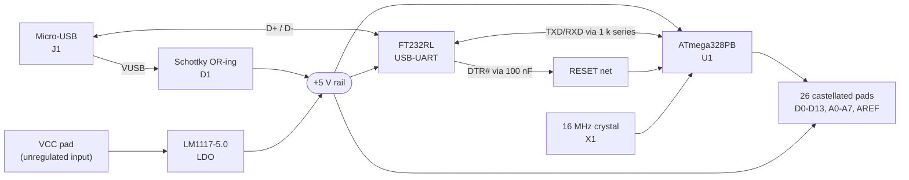
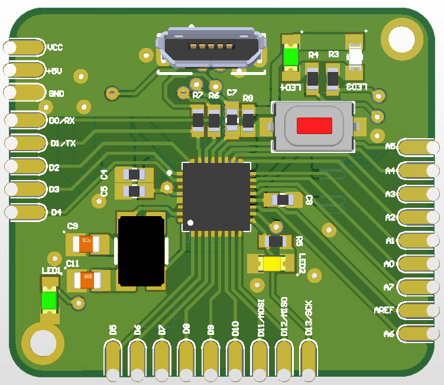
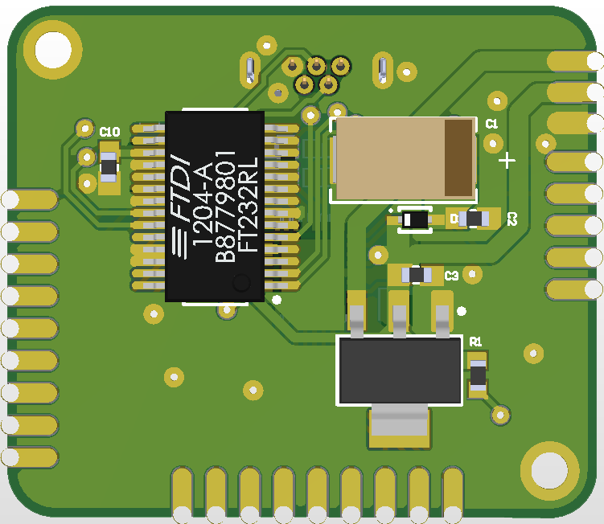
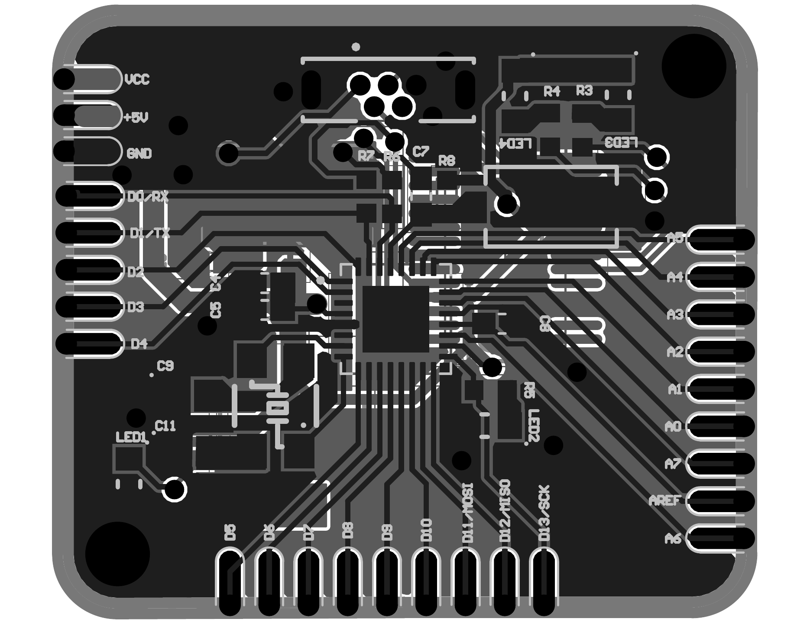
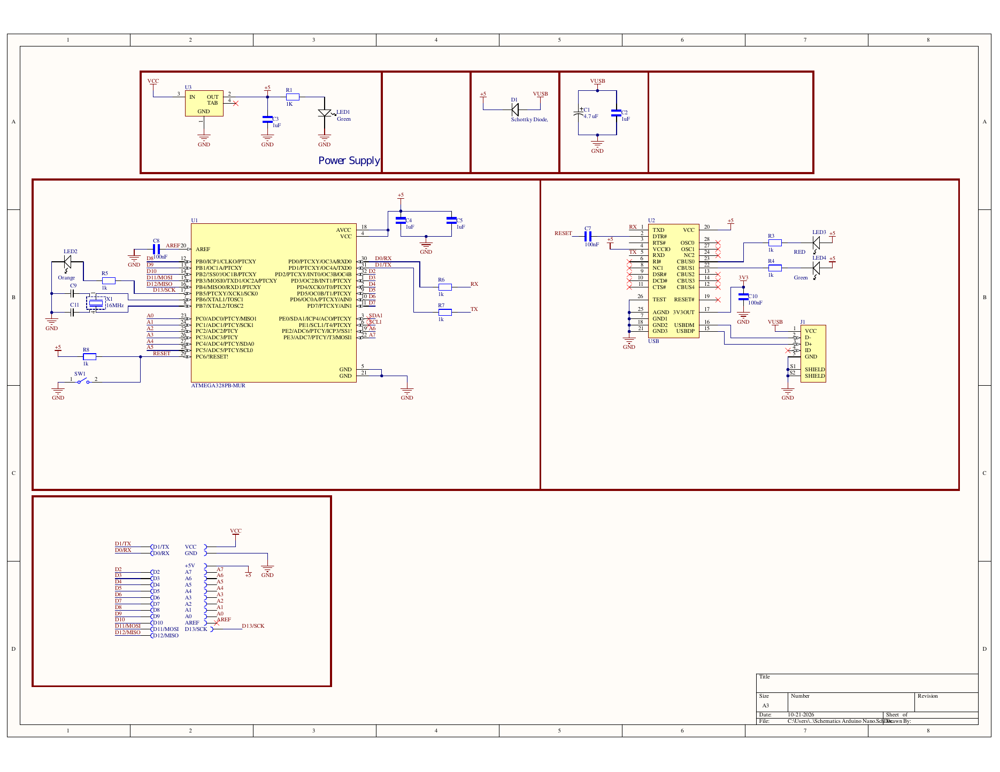

<div align="center">

# CORE-328PB

### Compact ATmega328PB Castellated Microcontroller Module

*A solder-down, USB-serial programmable 8-bit AVR module with an on-board 5 V regulator, source-OR-ed power path, and 26 castellated I/O pads. Designed in Altium Designer.*

<br>

[](https://www.microchip.com/en-us/product/ATmega328PB)
[](https://www.altium.com/)
[](CHANGELOG.md)
[](docs/BRINGUP_CHECKLIST.md)
[](LICENSE)

<br>


<sub><b>Figure 1</b> · 3D render of the CORE-328PB (Rev A), top side.</sub>

</div>

---

## Table of Contents

- [Overview](#overview)
- [Key Features](#key-features)
- [Specifications](#specifications)
- [System Architecture](#system-architecture)
- [Pinout Summary](#pinout-summary)
- [Board Views](#board-views)
- [Schematic](#schematic)
- [Repository Structure](#repository-structure)
- [Getting Started](#getting-started)
- [Documentation](#documentation)
- [Design Review Notes](#design-review-notes)
- [Roadmap](#roadmap)
- [Citation](#citation)
- [License](#license)

---

## Overview

**CORE-328PB** is a compact microcontroller module built around the **Microchip ATmega328PB** (32-pin VFQFN). It integrates everything needed to run and program the MCU from a single micro-USB cable, and exposes 26 signals on **castellated edge pads** so the module can be soldered directly onto a carrier board as an SMD component, or prototyped with pin headers.

The design intentionally separates concerns into four functional blocks: **power**, **USB-UART bridge**, **MCU core**, and **I/O breakout**, each documented independently in [`docs/HARDWARE_DESIGN.md`](docs/HARDWARE_DESIGN.md).

## Key Features

- **Microchip ATmega328PB** AVR, 32 KB Flash, 2 KB SRAM, 1 KB EEPROM, 16 MHz external crystal
- **FTDI FT232RL** USB-to-UART bridge with **DTR-driven auto-reset** for in-system serial programming
- **Dual power entry:** unregulated `VCC` input via **LM1117-5.0** LDO (800 mA class), or USB bus power through a **Schottky OR-ing diode**
- **26 castellated pads:** 14 digital (D0-D13), 8 analog (A0-A7), `AREF`, `+5V`, `VCC`, `GND`
- **Four status indicators:** power, user LED (D13), and two FT232RL CBUS-driven activity LEDs
- **On-board tactile reset switch**
- **Dense two-sided assembly** with rounded-corner outline and two mounting holes

## Specifications

| Parameter | Value |
|:--|:--|
| Microcontroller | ATmega328PB-MUR (VFQFN-32, 5 x 5 mm) |
| Clock | 16 MHz crystal (Aker C5S), 18 pF load capacitors |
| Logic level / core supply | 5 V |
| USB interface | Micro-B receptacle, FT232RL USB-UART bridge (UART at 5 V I/O) |
| Regulator | LM1117IMPX-5.0, SOT-223, 800 mA class LDO |
| USB power protection | Schottky diode D1 (0.5 A, 20 V) |
| Bulk / decoupling | 4.7 uF polymer tantalum (VUSB), 1 uF X5R on rails, 100 nF on AREF / FT232RL 3V3OUT / auto-reset |
| I/O | 26 castellated pads (see [Pinout](docs/PINOUT.md)) |
| Indicators | LED1 power, LED2 user (D13), LED3/LED4 FT232RL activity |
| EDA | Altium Designer |
| Revision / date | Rev A, 2026-10-21 |

## System Architecture



## Pinout Summary

Pad order as viewed from the **top side** of the board. The full pad-to-MCU-pin mapping is in [`docs/PINOUT.md`](docs/PINOUT.md).

| Edge | Pads (in order) |
|:--|:--|
| **Left** (top to bottom) | `VCC` · `+5V` · `GND` · `D0/RX` · `D1/TX` · `D2` · `D3` · `D4` |
| **Bottom** (left to right) | `D5` · `D6` · `D7` · `D8` · `D9` · `D10` · `D11/MOSI` · `D12/MISO` · `D13/SCK` |
| **Right** (top to bottom) | `A5` · `A4` · `A3` · `A2` · `A1` · `A0` · `A7` · `AREF` · `A6` |

## Board Views

<table>
  <tr>
    <td align="center"><br/><sub><b>Figure 2</b> · Top side: MCU, crystal, reset switch, status LEDs, USB connector</sub></td>
    <td align="center"><br/><sub><b>Figure 3</b> · Bottom side: FT232RL, LM1117 regulator, polymer tantalum</sub></td>
  </tr>
</table>

<p align="center">
  <br/>
  <sub><b>Figure 4</b> · PCB layout (monochrome fabrication view)</sub>
</p>

## Schematic

<p align="center">
  
</p>

<p align="center">
  <sub><b>Figure 5</b> · Rev A schematic: power supply, MCU core, USB-UART bridge, and I/O breakout. The full-resolution vector PDF (schematic, PCB, and BOM) is available in <a href="hardware/CORE-328PB_RevA_Schematic_PCB_BOM.pdf"><code>hardware/</code></a>.</sub>
</p>

## Repository Structure

```text
.
├── bom/
│   └── BOM.csv                  # Bill of materials with MPNs
├── docs/
│   ├── images/                  # Renders, layout, and schematic images
│   ├── HARDWARE_DESIGN.md       # Functional block design notes
│   ├── PINOUT.md                # Pad-to-MCU-pin mapping and alternate functions
│   └── BRINGUP_CHECKLIST.md     # Step-by-step validation procedure
├── hardware/
│   └── CORE-328PB_RevA_Schematic_PCB_BOM.pdf
├── CHANGELOG.md
├── LICENSE
└── README.md
```

> [!NOTE]
> Native Altium Designer project sources (`.PrjPcb`, `.SchDoc`, `.PcbDoc`) are not yet published in this repository. Fabrication outputs (Gerber / drill / pick-and-place) will be added under `hardware/` alongside the first validated release.

## Getting Started

### Power

| Source | Connection | Notes |
|:--|:--|:--|
| USB | Micro-B connector `J1` | Rail = VUSB minus the Schottky drop of D1 |
| External | `VCC` pad | Regulated to 5 V by LM1117-5.0. Keep input above regulator dropout and respect the datasheet limits. |
| Direct 5 V | `+5V` pad | Shares the 5 V rail. Do not drive it while another source is active. |

### Programming

1. Connect the module to a host via micro-USB. The FT232RL enumerates as a virtual COM port.
2. Flash firmware over the UART using a bootloader that supports DTR auto-reset (the reset line is wired through `C7`, 100 nF).
3. For a factory-blank device, program the bootloader and fuses first via **ISP** (SPI on `D11/MOSI`, `D12/MISO`, `D13/SCK` plus `RESET`). See [design review note 2](#design-review-notes) regarding RESET access.

> [!IMPORTANT]
> The module ships **without** a pre-programmed bootloader in this repository. The 16 MHz external crystal fuse settings must be configured before UART programming.

Follow [`docs/BRINGUP_CHECKLIST.md`](docs/BRINGUP_CHECKLIST.md) for first power-up validation.

## Documentation

| Document | Contents |
|:--|:--|
| [`docs/HARDWARE_DESIGN.md`](docs/HARDWARE_DESIGN.md) | Power path, MCU core, USB-UART bridge, indicators, design review findings |
| [`docs/PINOUT.md`](docs/PINOUT.md) | Complete pad table with MCU pin numbers and peripheral functions |
| [`docs/BRINGUP_CHECKLIST.md`](docs/BRINGUP_CHECKLIST.md) | Validation procedure for first assembly |
| [`bom/BOM.csv`](bom/BOM.csv) | Machine-readable bill of materials |
| [`CHANGELOG.md`](CHANGELOG.md) | Revision history |

## Design Review Notes

Findings from a self-review of the Rev A documentation. Details and suggested resolutions are in [`docs/HARDWARE_DESIGN.md`](docs/HARDWARE_DESIGN.md#design-review-findings).

1. **BOM data error:** the 100 nF capacitors (`C7`, `C8`, `C10`) reference a library part whose description and MPN correspond to a **1 uF** capacitor. Correct the part number before ordering.
2. **RESET is not broken out** to the castellated pads, so ISP of a blank device requires direct access to the reset net (e.g., `SW1` pad or test point).
3. **Reset pull-up value:** `R8` is 1 kOhm; this is lower than the more common 10 kOhm and should be confirmed against the auto-reset timing during bring-up.
4. **Unused peripherals:** `PE0/SDA1` and `PE1/SCL1` are marked no-connect; the second I2C, second SPI, USART1, and extra timers of the ATmega328PB are not exposed in Rev A.

## Roadmap

- [x] Schematic capture and PCB layout (Rev A)
- [x] BOM compiled with manufacturer part numbers
- [ ] Correct BOM data for 100 nF capacitors
- [ ] Fabrication and assembly of first prototypes
- [ ] First power-up and bring-up per checklist
- [ ] Bootloader and fuse configuration documented
- [ ] Rev B: expose RESET, evaluate additional ATmega328PB peripherals
- [ ] Publish Altium sources and fabrication outputs

## Citation

```bibtex
@misc{core_328pb_module,
  title  = {CORE-328PB: Compact ATmega328PB Castellated Microcontroller Module},
  author = {Abdelrahman Hesham},
  year   = {2026},
  note   = {Hardware design, Rev A},
  url    = {https://github.com/ae-hesham/CORE-328PB}
}
```

## License

This project is licensed under a Proprietary License. See the [LICENSE](LICENSE) file for details.

<div align="center">
<br>
<sub>Designed in Altium Designer · Made by Abdelrahman Hesham</sub>
</div>
